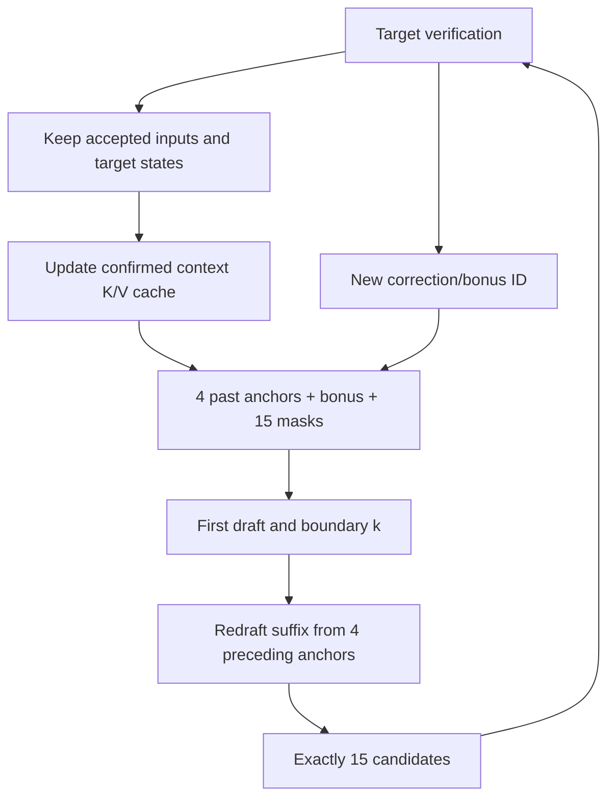

# Four-anchor vLLM inference: known bonus and cached context

This version reuses the trained checkpoint and removes the additional target
forward from the old adapter. Target execution, target paged KV, scheduling,
and greedy rejection sampling run in vLLM-Ascend. The drafter runs inside the
same worker with cached context projections and PyTorch SDPA.

## Exact token layout

For eight accepted draft tokens followed by the target correction/bonus at
position nine, the next first pass uses:

| Input | Contents |
| --- | --- |
| Four past anchors | Tokens 5, 6, 7, 8 and their existing target features |
| Known bonus slot | Token 9's embedding, with no fabricated target features |
| Fifteen mask slots | Predict tokens 10 through 24 |

There are **20 query positions**, matching the trained width of four anchors
plus sixteen slots. The first of those sixteen slots is now fixed to a known
token; this input pattern differs from the original all-mask training and its
acceptance must be measured. No checkpoint file or training setting is changed.

The shared drafter runs twice. Confidence scores select a boundary `k` from the
15 future-token predictions, excluding the known bonus. Pass two uses the four
positions immediately before `n + 1 + k`. Positions before `n` use target
features; positions at/after `n` use first-pass draft features, including the
known bonus's first-pass draft state where applicable. Pass two keeps the same
20-position shape (four anchors plus sixteen masks); only its first `15-k`
predictions replace the suffix. The final proposal is exactly 15 tokens.



The bonus remains pending in the ordinary vLLM scheduler. The next target call
processes **the pending bonus + 15 candidates together**. There is no separate
bonus-materialization target call and no write to an unallocated target KV page.
Rejected target states never enter persistent draft memory. On a new request the
cache is reset; on rollback its valid length is truncated. Near the maximum
context length, the adapter stops proposing and vLLM finishes autoregressively.

The maximum draft acceptance is **15**, and including one target correction/bonus
it is **16**. The four anchors and the pending bonus input are not additional
accepted proposals. Native metrics count before EOS/output-budget trimming.

## Optimizations included

- Project only newly confirmed target context. Cache each layer's context K/V
  and share it across both passes and subsequent verification cycles.
- Vectorized anchor construction, on-device confidence boundary and suffix
  selection. No `.item()` or `.tolist()` between the two draft passes.
- Precomputed rotary tables and persistent context buffers. Only the pinned
  custom-proposer API's final candidate-list transfer remains necessary.
- No vocabulary projection for the already-known bonus token.
- Per-cycle JSON tracing is off by default; pooled acceptance metrics remain.
- Optional bucketed drafter ACLGraph replay. Target execution remains eager.
- KV-cache block size explicitly 128 for the pinned Ascend attention backend.

Concurrency is **one**, with TP=PP=DP=1 and greedy sampling. Prefix caching,
chunked prefill, async scheduling, quantization and LoRA are disabled. These are
implementation limits, not training requirements.

## Install into the existing pipeline

Extract the latest `fix.zip` and run `four-anchor-dflash/install_vllm.sh ROOT`.
It backs up modified files, installs only inference files, and includes the
bias-free RMSNorm fallback already validated on the user's CANN 9.1 environment.
It preserves the existing training source, saved checkpoints and other edits.
It does not install packages, reset submodules, commit or push.

`VLLM_SOURCE_ROOT` now defaults to the pipeline root, whose initialized submodules
must match vLLM `77b1d88c5b52abaf6a103292119f3435b51699d9` and vLLM-Ascend
`276a5c840b21c83b153d3ebd831720bc926dfc4e`.

## Run the first checkpoint on NPU 7

```bash
conda activate attention_prefix_ali
ROOT=/home/n84449292/a84384644/attention_head_forked/four-anchor-dflash-pipeline
EVAL_NPU=7 LIMIT=128 MAX_NEW_TOKENS=2048 \
  bash "$ROOT/four_anchor/scripts/vllm_ascend.sh" evaluate
```

Defaults use `checkpoint-016699` from
`output/four_anchor_dflash_20261031_025300_2111006`, and the 128 local GSM8K prompts
in that run's `evaluation/epoch1_gsm8k_20261102_230727/prompts.jsonl`.
Override `DRAFT`, `MODEL`, `DATA`, `RUN`, or `OUTPUT_DIR` explicitly when needed.
A fresh output directory is required for each evaluation.

The startup event must show `inference_version: known_bonus_cached_v1`,
`conditioning_anchors: 4`, `known_bonus_slots: 1`, `query_positions: 20`,
`serving_proposals: 15`, and `extra_target_forwards: 0`.

## Compare with ordinary Qwen3-4B

```bash
EVAL_NPU=7 LIMIT=128 MAX_NEW_TOKENS=2048 \
  bash "$ROOT/four_anchor/scripts/compare_vllm.sh"
```

This runs ordinary Qwen3 and two-pass speculation sequentially on the same NPU,
with identical prompts and budgets. It checks token-for-token greedy agreement,
reports acceptance and speedup, and saves `comparison.json`. Set
`COMPARE_ONE_PASS=1` to include the one-pass ablation. The baseline uses the same
eager target setting; this is not a comparison against a graph-optimized AR
baseline. A parity failure retains results but exits nonzero and makes the
speedup provisional. BF16 shape-dependent differences need investigation.
This benchmark measures generation, not GSM8K mathematical-answer accuracy.

## Optional drafter graph mode

`DRAFT_GRAPH=0` is the default. To test the experimental graph path first:

```bash
DRAFT_GRAPH=1 EVAL_NPU=7 LIMIT=4 MAX_NEW_TOKENS=128 \
  bash "$ROOT/four_anchor/scripts/compare_vllm.sh"
```

The drafter's two-pass body is captured in context buckets up to `MAX_MODEL_LEN`.
Length, bonus ID, token history and cached context tensors are updated on every
replay. Padded context keys are masked. Capture happens during memory profiling,
so persistent graph allocations are included before vLLM reserves its target KV
cache. The target transformer remains eager; this does not enable native vLLM
target graphs. Graph capture/replay requires validation on the actual NPU/CANN
stack. If it fails, `DRAFT_GRAPH=0` still provides cached drafting with no extra
target call. No automatic silent fallback is used for graph failures.

## Profile and diagnose

```bash
PROFILE_STEPS=12 EVAL_NPU=7 LIMIT=4 MAX_NEW_TOKENS=128 \
  bash "$ROOT/four_anchor/scripts/vllm_ascend.sh" evaluate
```

Synchronized `four_anchor_profile` entries measure context-cache updates,
first pass, boundary work, second pass, and final transfer to the host. Graph mode
reports the combined graph-replay region instead of individual passes. These
are drafter-region timings, not target-forward timings. Profiling changes
execution overhead, so leave `PROFILE_STEPS=0` for throughput measurement.
`TRACE_STEPS=1` restores verbose per-verification JSON for debugging.

## Validation scope

CPU tests compare cached and uncached full-context equations, all 15 boundaries,
short prompts, cache append/rollback/reset, graph padding and replay-input
refresh, adapter exclusion of rejected features, and exact greedy decoding
with one target call per verification. The complete pipeline regression suite
is included. Actual Ascend execution, graph replay and speedup for this new
version are not claimed by these CPU tests. Training files and checkpoint bytes
are unchanged.
