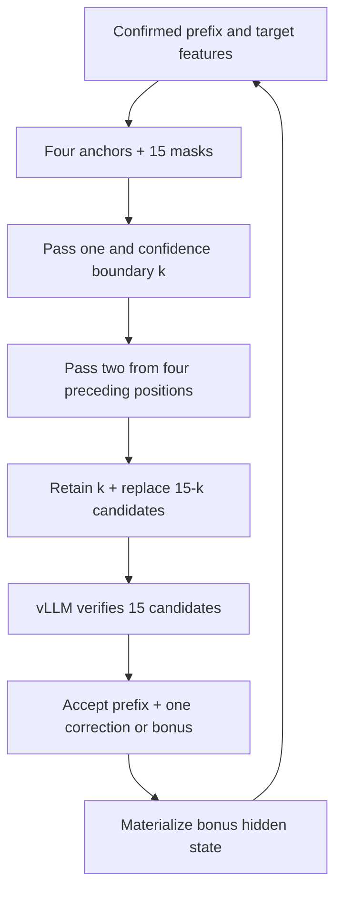

# Four-anchor inference with vLLM on Ascend

The target transformer, paged target KV cache, scheduling and greedy verification run in **vLLM-Ascend**. The trained four-anchor drafter runs inside the same worker using its PyTorch/SDPA equations. There is no Transformers target model and no hidden-state HTTP/file transfer in this inference path. The frozen target embedding/head are loaded separately for the drafter, which costs additional memory.

This is an initial, eager, synchronous **single-request / single-NPU** integration for the pinned repository revisions. CPU tests cover the proposal window, anchors, rollback, bonus positions and adapter orchestration. **No actual Ascend execution or speedup is claimed yet.** It is not a fused/paged vLLM draft-model implementation; context projections are recomputed on each draft pass.

## Token counts

| Quantity | Count |
| --- | ---: |
| Existing checkpoint training anchors | 4 |
| Existing checkpoint trained proposal slots | 16 |
| New vLLM inference conditioning anchors | 4 |
| New vLLM inference speculative slots | 15 |
| Drafter query positions in each pass | 19 |
| Final candidates sent to the verifier | 15 |
| Maximum draft-only acceptance | 15 |
| Maximum acceptance including one target correction/bonus | 16 |

The serving override changes the in-memory query shape; it does not rewrite the trained checkpoint or mean that it was trained with 15 slots. Its quality at 15 slots needs measurement. Four anchors are existing context tokens, never four bonus tokens.

Both passes use the **same weights**. Pass one generates 15 candidates. The existing confidence selector chooses a predicted first-error boundary `k` in `[0,14]`. Pass two uses the four positions immediately preceding the restart, with real target features for confirmed positions and first-pass draft features for retained proposals. Its first `15-k` predictions replace the suffix. The verified sequence is `first[:k] + second[:15-k]`, exactly 15 positions. Unlike the old Transformers two-pass runtime, this does not extend the proposal window.



The bonus must be processed to obtain its actual hidden state. The adapter runs an additional one-token vLLM target forward, using the accepted-prefix KV length. The scheduler later processes that token normally again; the adapter does not advance scheduler counters privately. Rejected KV positions are excluded from attention, and rejected features are discarded. If no KV page is allocated for the bonus position, drafting is skipped for that iteration and normal target decoding advances the sequence. This adds work and must be included in throughput measurements.

## Evaluate the first checkpoint

Run inside the existing `attention_prefix_ali` environment, using an available NPU. The script uses the existing local GSM8K prompts and disables Hub access. It neither starts training nor kills existing processes.

```bash
conda activate attention_prefix_ali
ROOT=/home/n84449292/a84384644/attention_head_forked/four-anchor-dflash-pipeline

# Default: checkpoint-016699, physical NPU 7, 128 local prompts, 2048 output tokens.
EVAL_NPU=7 LIMIT=4 MAX_NEW_TOKENS=128 \
  bash "$ROOT/four_anchor/scripts/vllm_ascend.sh" evaluate
```

Begin with the four-prompt hardware smoke run above. A successful run must show `four_anchor_vllm_loaded`, `target_backend: vllm-ascend`, `serving_proposals: 15`, and nonzero native speculative metrics. Then compare with plain vLLM Qwen3 on identical prompts:

```bash
RUN="$ROOT/output/four_anchor_dflash_20261031_025300_2111006"
EVAL_ROOT="$RUN/evaluation/vllm_comparison_$(date +%Y%m%d_%H%M%S)"

# Run sequentially on the same NPU for the cleanest speed comparison.
MODE=ar EVAL_NPU=7 OUTPUT_DIR="$EVAL_ROOT/ar" \
  bash "$ROOT/four_anchor/scripts/vllm_ascend.sh" evaluate

MODE=two_pass EVAL_NPU=7 OUTPUT_DIR="$EVAL_ROOT/two_pass" \
  BASELINE="$EVAL_ROOT/ar/per_prompt.jsonl" \
  bash "$ROOT/four_anchor/scripts/vllm_ascend.sh" evaluate
```

`summary.json` reports pooled throughput (total emitted tokens / total timed seconds), native draft-only acceptance, acceptance including one bonus, and exact output-token agreement when `BASELINE` is supplied. Model loading and warmup are excluded; prefill and all worker drafting/materialization are included. Native acceptance counts verification before EOS or output-budget truncation, so it is not necessarily emitted tokens divided by cycles. Failed output agreement makes the benchmark exit with an error after writing the results. This evaluates decoding correctness and speed; it does not score GSM8K answer accuracy.

`MODE=one_pass` is an ablation using the same four-anchor checkpoint and 15 candidates. `MODE=ar EVAL_NPU=1` selects plain Qwen3 on the second physical card. Concurrent runs can contend for host resources, so use sequential runs for final speed claims.

## Start a vLLM API server

```bash
EVAL_NPU=7 PORT=8095 \
  bash "$ROOT/four_anchor/scripts/vllm_ascend.sh" serve
```

Use `http://127.0.0.1:8095/v1`, model `four-anchor-qwen3`, and **temperature 0**. The server uses vLLM's standard OpenAI API. Sampling at other temperatures is rejected by the worker in this initial adapter. Concurrency is serialized with `max_num_seqs=1`.

## Paths and compatibility

Defaults:

- `DRAFT=$RUN/checkpoints/checkpoint-016699`.
- `DATA=$RUN/evaluation/epoch1_gsm8k_20261102_230727/prompts.jsonl`.
- `NUM_SPECULATIVE_TOKENS=15`, `MAX_MODEL_LEN=4096`, `MEMORY_FRACTION=0.8`.
- `VLLM_SOURCE_ROOT=/home/n84449292/a84384644/attention_head_forked/attention_prefix_head`.

The source check requires vLLM `77b1d88c5b52abaf6a103292119f3435b51699d9` and vLLM-Ascend `276a5c840b21c83b153d3ebd831720bc926dfc4e`, the commits pinned by this branch. It does not change your existing source checkout. The current implementation requires v1, TP=PP=DP=1, unquantized dense Qwen3, no LoRA/KV transfer, no prefix caching, no chunked prefill, and no graph capture. Those restrictions ensure the complete target-feature history is available and that the extra bonus forward uses the supported metadata layout.

`check` prints the resolved engine configuration without loading a target or starting a server. It is a configuration check, not an NPU kernel test. The old `python -m four_anchor.cli evaluate/serve` commands remain the Transformers reference; use the new script for vLLM.
